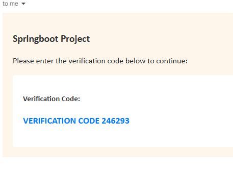

# Spring Boot Authentication API

A Java backend project for learning how to build an authentication API with Spring Boot. Users register, verify their email address, and log in to receive a JSON Web Token (JWT) for accessing protected endpoints.

I built this project to understand how HTTP requests, business logic, database persistence, email delivery, and security work together in a backend application.

## Introduction to Spring Boot

Spring Boot simplifies building standalone Java applications with the Spring framework. Starter dependencies and automatic configuration reduce setup, while an embedded web server lets the API run without installing a separate application server.

In this project, controllers handle HTTP requests, services contain business logic, and a Spring Data JPA repository accesses PostgreSQL. Constructor injection connects these components. Spring Security controls access to endpoints, and application properties load local settings from `.env`.

## What this project touches on

- **REST API development:** Mapping URLs to controller methods, receiving JSON through DTOs, and returning HTTP responses.
- **Application structure:** Separating controllers, services, repositories, entities, and configuration by responsibility.
- **Dependency injection:** Supplying dependencies through constructors instead of creating them inside each class.
- **Database persistence:** Mapping Java entities to PostgreSQL tables with JPA and querying users through a repository.
- **Password protection:** Hashing passwords with BCrypt rather than storing plain text passwords.
- **Authentication and JWTs:** Checking login credentials, issuing tokens, and authenticating later requests through a filter without server-side login sessions.
- **Email verification:** Generating codes, setting expiry times, sending verification emails, and enabling verified accounts.
- **Configuration and debugging:** Connecting Supabase and Gmail SMTP, and distinguishing JDBC formatting problems, network failures, invalid credentials, and HTTP access errors.
- **API testing:** Using Postman to test the complete account lifecycle and protected endpoints.

## Technology stack

| Technology | Purpose |
| --- | --- |
| Java 25 | Application language and configured toolchain |
| Spring Boot 4.1.1 | Application configuration and embedded server |
| Spring Web MVC | REST endpoints and JSON handling |
| Spring Security | Authentication and access control |
| Spring Data JPA | Entity persistence and repository access |
| PostgreSQL / Supabase | User database |
| Spring Mail / Gmail SMTP | Verification emails |
| JJWT | JWT generation and validation |
| Lombok | Generated getters and setters |
| Gradle wrapper | Building, running, and testing |
| Postman | Manual API testing |

## Run locally

### Prerequisites

- JDK 25, configured in your terminal and IDE.
- An accessible PostgreSQL database, such as a Supabase project.
- A Gmail account with an app password for SMTP.
- Postman for manual testing.

The Gradle wrapper is included, so a separate Gradle installation is unnecessary.

### Environment configuration

Create `.env` in the project root and replace these placeholders:

```properties
# Supabase Session pooler connection details
SPRING_DATASOURCE_URL=jdbc:postgresql://YOUR_POOLER_HOST:5432/postgres?sslmode=require
SPRING_DATASOURCE_USERNAME=postgres.YOUR_PROJECT_REF
SPRING_DATASOURCE_PASSWORD=YOUR_DATABASE_PASSWORD

# Base64-encoded random signing key: at least 32 decoded bytes
JWT_SECRET_KEY=YOUR_BASE64_SECRET

# Gmail SMTP credentials
SUPPORT_EMAIL=your-account@gmail.com
APP_PASSWORD=YOUR_GMAIL_APP_PASSWORD
```

For local PostgreSQL, use `jdbc:postgresql://localhost:5432/YOUR_DATABASE` and local credentials instead.

Keep the URL separate from the username and password. Write passwords literally, without URL encoding or surrounding quotes. Spring imports this `.env` as a Java properties file: `#` inside a value is valid; a line beginning with `#` is a comment.

`.env` is ignored by Git. Keep real credentials and tokens out of documentation and screenshots. Hibernate uses `ddl-auto=update`, so use a development database where schema changes are acceptable.

### Build and start

Run from the project root in PowerShell:

```powershell
.\gradlew.bat build
.\gradlew.bat bootRun
```

The default base URL is `http://localhost:8080`. Stop the app with `Ctrl+C`. Restart after changing local configuration.

## Testing with Postman

Create and select a Postman environment containing:

| Variable | Value |
| --- | --- |
| `baseUrl` | `http://localhost:8080` |
| `email` | An inbox you can access |
| `password` | A test account password |
| `token` | Initially empty |

For JSON requests, choose **Body → raw → JSON**. This sets `Content-Type: application/json`. Choose **Authorization → No Auth** for `/auth` requests to avoid sending an inherited token.

### 1. Register

**POST** `{{baseUrl}}/auth/signup`

```json
{
  "username": "testuser",
  "email": "{{email}}",
  "password": "{{password}}"
}
```

Expect **200 OK**, a user response with `enabled: false`, and an email containing a six-digit verification code. Check spam too. Use a unique username and email for each new registration.

### 2. Verify the account

**POST** `{{baseUrl}}/auth/verify`

Replace the example code with the one received by email:

```json
{
  "email": "{{email}}",
  "verificationCode": "123456"
}
```

Expect **200 OK** with this text response:

```text
Account verified successfully
```

The initial code expires after 15 minutes. Verify the account before logging in.

### 3. Log in

**POST** `{{baseUrl}}/auth/login`

```json
{
  "email": "{{email}}",
  "password": "{{password}}"
}
```

Expect **200 OK** and a response shaped like:

```json
{
  "token": "<generated-jwt>",
  "expiresIn": 3600000
}
```

`expiresIn` is in milliseconds; the configured lifetime is one hour. Copy the token into the environment variable, or add this under **Scripts → Post-response**:

```javascript
pm.test("Login succeeds and returns a token", function () {
    pm.response.to.have.status(200);
    const body = pm.response.json();
    pm.expect(body.token).to.be.a("string").and.not.empty;
    pm.environment.set("token", body.token);
});
```

### 4. Get the authenticated user

**GET** `{{baseUrl}}/users/me`

Choose **Authorization → Bearer Token** and enter `{{token}}`. No body is required. Postman sends:

```http
Authorization: Bearer <generated-jwt>
```

Expect **200 OK** with the authenticated user's details. Add a Post-response check:

```javascript
pm.test("Returns the authenticated user", function () {
    pm.response.to.have.status(200);
    pm.expect(pm.response.json().email)
        .to.eql(pm.environment.get("email"));
});
```

### 5. List users

**GET** `{{baseUrl}}/users/`

Use **Bearer Token** with `{{token}}`. Expect **200 OK** and a JSON array of users. Include the trailing slash in this route.

### 6. Resend a verification code

For an unverified account, send **POST** `{{baseUrl}}/auth/resend`.

In **Params**, add the key `email` with value `{{email}}`. No JSON body or Bearer token is required.

Expect **200 OK** with `Verification code sent`. Resending replaces the previous code, so use the newest email. An already verified account returns **400 Bad Request**.

### Test rejected requests

| Test | Expected behaviour |
| --- | --- |
| Request `/users/me` without a token | Access rejected |
| Verify an unverified account with an incorrect code | `400 Bad Request`: `Invalid verification code` |
| Verify with an expired code | `400 Bad Request`: `Verification code has expired` |
| Log in before verification | Login rejected; no token issued |
| Log in with an incorrect password | Login rejected; no token issued |

Some authentication errors do not yet have consistent HTTP error responses. Check the application terminal when a request fails unexpectedly.

### Troubleshooting

- **403 on signup:** Use `POST /auth/signup` and No Auth. Confirm the running app permits `/auth/**` and restart after configuration changes.
- **403 on a protected route:** Log in and send the returned JWT as a Bearer token.
- **Invalid database URL:** Use the `jdbc:postgresql://` prefix and separate credential settings.
- **Unknown database host:** Check the hostname and network. Use Supabase Session pooler details when your network requires IPv4.
- **Database authentication failed:** Check the connection's username and the literal database password, without URL encoding.
- **No verification email:** Check spam, Gmail SMTP configuration, the app password, and application logs.

## Automated test

```powershell
.\gradlew.bat test
```

The existing `DemoApplicationTests.contextLoads()` test checks that the Spring application context starts. It needs valid configuration and database connectivity. It does not test the full registration and login flow.

Open `build/reports/tests/test/index.html` after running the test. The `build` command also runs tests.

## Result


